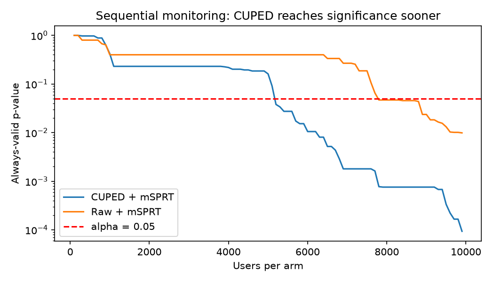
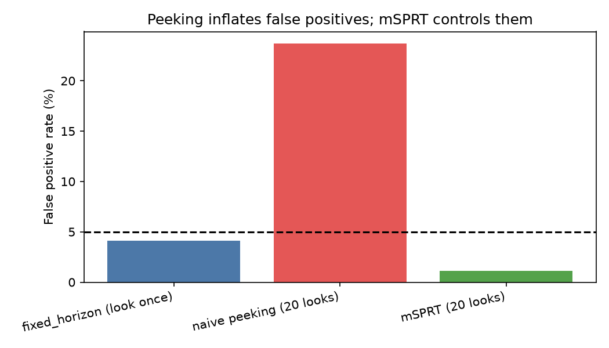

# A/B Test Analysis Toolkit: CUPED and Sequential Testing

A Python toolkit for analyzing online experiments faster and more safely than a standard t-test. It uses pre-experiment data (CUPED) to reduce the sample size needed, and always-valid sequential testing (mSPRT) so a test can be monitored continuously without inflating false positives.



## Results

All results come from **simulated experiments** with a known true effect, so each method can be checked against ground truth. Settings: 20,000 users, pre/post correlation of 0.7, true lift of 3%, seed 42.

| Metric | Standard approach | This toolkit |
|---|---|---|
| Users per arm needed to detect a +1.0 effect | 6,320 | **3,233** (-49%) |
| 95% interval width on the estimated effect | 1.11 | **0.80** |
| Users per arm at first decision point (sequential) | 7,800 | **5,200** |
| False positive rate, 20 interim looks (target 5%) | 23.7% | **1.1%** |

The size of the gain depends on how well the pre-experiment metric predicts the experiment metric. Variance shrinks by roughly the squared correlation, so a weak predictor gives a small benefit.

## The problem

1. **Experiments are slow.** Noisy metrics such as revenue per user need large samples to detect small effects.
2. **Early looks break the statistics.** Teams check dashboards daily, but stopping at the first significant p-value produces false winners much more often than the nominal 5%.

## Approach

### 1. CUPED variance reduction

Each user's metric is adjusted using their own behavior before the experiment (Deng et al., 2013):

```
Y_adj = Y - θ · (X - mean(X)),     θ = Cov(X, Y) / Var(X)
```

This removes variance the pre-period already explains, shrinking it by a factor of `1 - ρ²`. The treatment effect stays unbiased because `X` is measured before randomization.

### 2. Always-valid sequential testing

A mixture sequential probability ratio test (mSPRT; Johari et al., 2015) produces a p-value that can be checked at any time. Stopping the first time it drops below α keeps the false positive rate at or below α. Applying CUPED first lets the p-value reach the threshold at a smaller sample size (chart at the top).

### 3. Why peeking is dangerous

The simulation runs 1,000 A/A tests (no true effect) with 20 looks each, and compares a naive repeated test against mSPRT. mSPRT lands well under 5% because it is deliberately conservative.



## Quick start

```bash
git clone https://github.com/<your-username>/ab-testing-platform.git
cd ab-testing-platform
pip install -r requirements.txt

python -m tests.test_core        # verify the statistics
python -m src.run_pipeline       # reproduce the results, saves charts to outputs/
python -m streamlit run app.py   # launch the dashboard
```

## Dashboard

A Streamlit app with three views: fixed-horizon results (raw vs CUPED), sequential monitoring, and a peeking check. It runs on simulated data or your own CSV with the columns `group` (0 = control, 1 = treatment), `metric` and `pre_metric`.

<!--
Dashboard screenshots: save them in docs/ then remove this comment markers.


-->

## Project structure

```
src/
  simulate.py            synthetic experiment with a pre-experiment covariate
  stats_tests.py         Welch t-test, sample size calculation
  cuped.py               CUPED adjustment and variance reduction
  sequential.py          mSPRT always-valid p-values
  peeking_simulation.py  A/A simulation of peeking
  run_pipeline.py        end-to-end run, produces results and charts
tests/
  test_core.py           statistical property tests
app.py                   Streamlit dashboard
outputs/                 charts generated by the pipeline
```

## Testing

The tests check statistical properties, not just that the code runs:

- variance reduction matches the theoretical `ρ²`
- the CUPED estimate is unbiased across 200 repeated experiments
- peeking pushes false positives above 10% while mSPRT stays under 7%

## Limitations

- Results use simulated data. Real gains depend on the correlation between the pre-experiment and experiment metrics.
- `θ` is estimated from the experiment data itself. Production setups usually fit it on a prior period.
- mSPRT assumes approximately normal sample means and needs a prior scale `tau`, which the user chooses.
- A single metric is analyzed, with no multiple-testing correction.

## Possible extensions

- Validate on a real dataset that has a pre-period metric
- Group-sequential boundaries (O'Brien-Fleming) as a comparison to mSPRT
- Segment-level and uplift analysis

## References

- Deng, Xu, Kohavi, Walker. *Improving the Sensitivity of Online Controlled Experiments by Utilizing Pre-Experiment Data* (2013)
- Johari, Pekelis, Walsh. *Always Valid Inference* (2015)